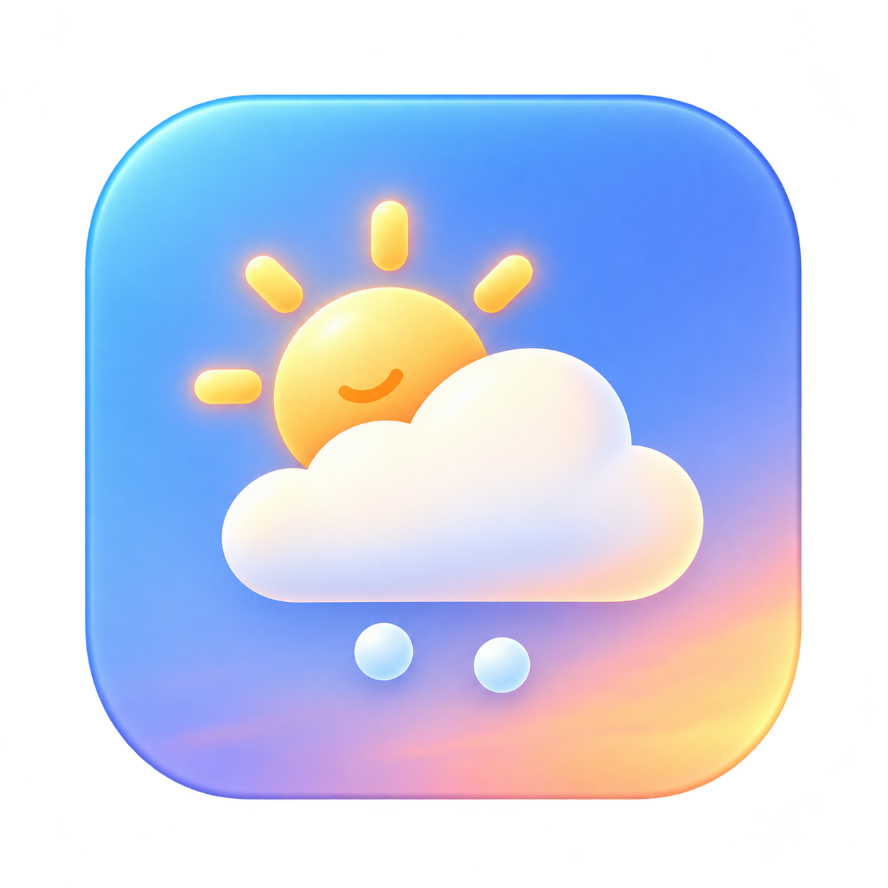

<p align="center">
  
</p>
<h1 align="center">Weather Desktop</h1>
<p align="center"><strong>A little weather. A happier desktop.</strong></p>
<p align="center">Native macOS · Snow & autumn leaves · MIT · 0.9.0 release candidate</p>

Bring soft snowfall and drifting autumn leaves to your Mac. Watch them settle on window edges, then tumble down when you move a window. Tune the atmosphere from a glass settings panel with a live preview.

> **Release status:** source package ready for GitHub. The portable C++ core has passed local tests; the native macOS build and UI still need a successful Mac/Actions run. This repository does not yet provide a verified stable binary. [Verification record](docs/VERIFICATION.md).

[Инструкция публикации на русском](docs/PUBLISH_RU.md) · [Release guide](docs/RELEASE.md) · [Security](SECURITY.md)

## Make it your weather

| Atmosphere | Controls |
| --- | --- |
| Snow & autumn | Textured snow banks, drifting and rotating leaves, window-edge accumulation |
| Your pace | Fall speed, particle density, wind, accumulation and a desktop-floor toggle |
| Quick moods | Quiet, Breeze and Storm presets; save one favorite profile |
| A little play | Shake accumulated particles off the windows |
| Glass & color | Frosted and Liquid Glass button styles, adjustable tint, live preview |
| Everyday use | Click-through overlays, Dock icon, menu bar controls and an Eco mode |

Liquid Glass uses the native system class where available and falls back to AppKit visual effects on older systems. The built-in interface is currently in Russian.

## Get the app

After a successful **Build and tests** run, download a `local-test-*` artifact from the repository's **Actions** page. It contains a universal application ZIP, a DMG and SHA-256 checksums. You need to be signed in to GitHub to download Actions artifacts.

Open the DMG and drag **Weather Desktop.app** to **Applications**. Open the app, then keep its icon in the Dock if you like. A compiled application runs without Terminal or source files.

These artifacts use an **ad-hoc signature for testing**. Developer ID signing and Apple notarization remain a separate release step; follow the [release guide](docs/RELEASE.md). No successful Actions run or notarized release is claimed in this source package.

### Build and install locally

On a Mac with Apple Command Line Tools, open **Install.command**. It builds once, installs the app into `~/Applications` and opens it. If the tools are missing, complete Apple's installation and run it again. After successful installation you can remove the installer folder.

The deployment target is macOS 11+. Compatibility at that minimum has not yet been verified on hardware. Apple Silicon and Intel universal packaging is configured.

```bash
bash scripts/build.sh
open 'build/Weather Desktop.app'
```

## Development

The app uses Objective-C++, C++17 and Apple's system frameworks. No third-party runtime dependencies are bundled.

```bash
bash scripts/test.sh          # portable physics and settings tests
SANITIZE=1 bash scripts/test.sh
bash scripts/check-macos.sh   # Mac: build and AppKit smoke test
bash scripts/package.sh       # Mac: universal ZIP + DMG + checksums
```

| Path | Responsibility |
| --- | --- |
| `src/Snow.hpp` | Particle simulation and collisions |
| `src/Powder.hpp` | Snow-bank texture rendering |
| `src/main.mm` | App lifecycle, overlays and drawing |
| `src/Controls.inc` | Settings and live preview |
| `scripts/` | Build, installation, tests and packaging |
| `tests/` | Core regressions and AppKit smoke checks |

GitHub Actions runs core tests on Linux and native checks on Apple Silicon / Intel macOS runners. **Prepare release draft** is a separate manually triggered workflow: after successful testing and packaging, it creates a draft prerelease for the owner to review. It does not publish the release automatically.

For a contribution, keep the change focused, run the relevant tests and include macOS version, screenshots or reproduction steps when changing UI behavior. Report sensitive security issues according to [SECURITY.md](SECURITY.md).

## Privacy & performance

The reviewed source uses window geometry to position the effects and stores preferences locally. It contains no network client, analytics or document-reading functionality. The app is not sandboxed. [Security details](SECURITY.md).

Per display, the simulation caps airborne particles at 2,000 and tracked windows at 64. Each surface stores up to 1,600 settled leaves. Eco mode runs at 20 fps instead of 30; animation stops when the display sleeps or the user session becomes inactive. CPU, memory and battery measurements on real Macs are still pending.

Window interaction is based on rectangular bounds. Unusual window shapes, Spaces, fullscreen applications and multiple display layouts need visual testing before a stable release.

## Uninstall

Quit Weather Desktop and move its `.app` to the Trash. To remove preferences:

```bash
defaults delete local.windowsnow.desktop
```

The internal identifier is retained from the original WindowSnow name to preserve existing settings. If present, remove `~/Library/Saved Application State/local.windowsnow.desktop.savedState`. The app does not install background services or login items. Build and installation backups live inside the installer/project folder and can be removed with it after checking the new version.

## Credits & license


Released under the [MIT License](LICENSE).
